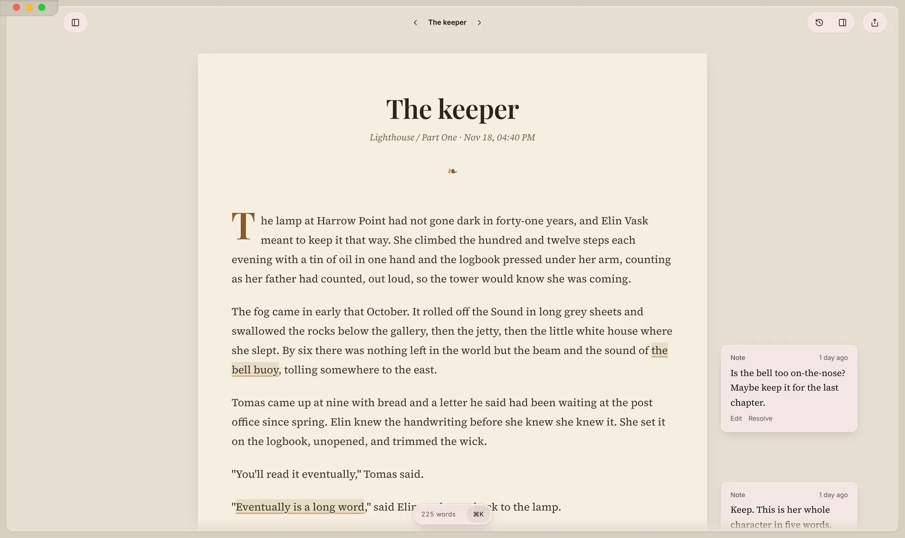
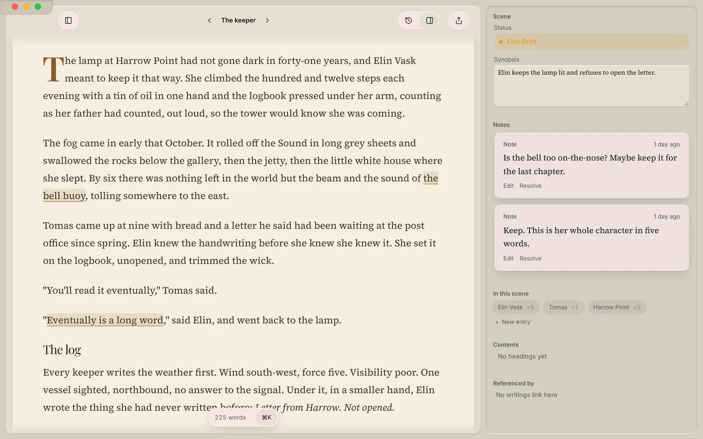
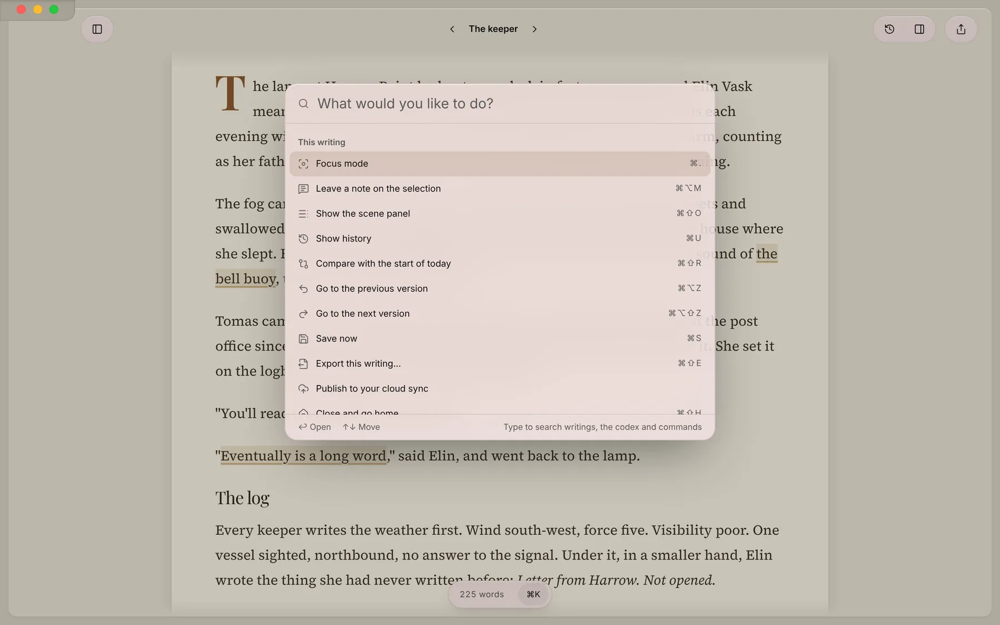
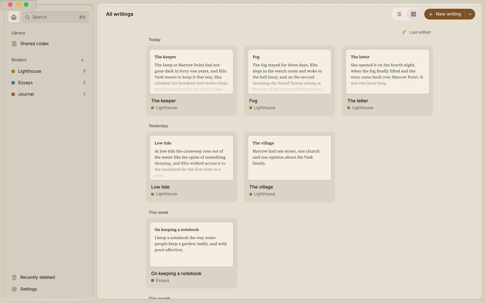
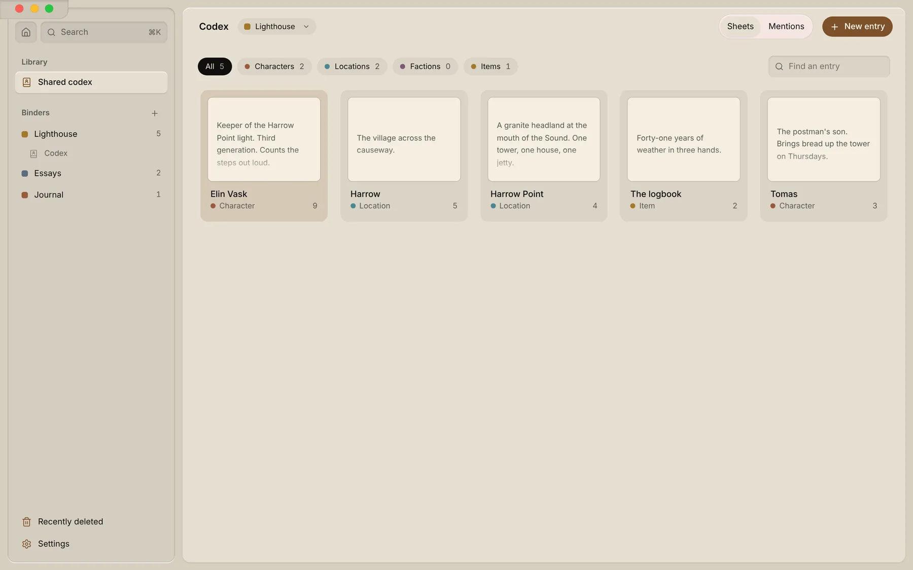
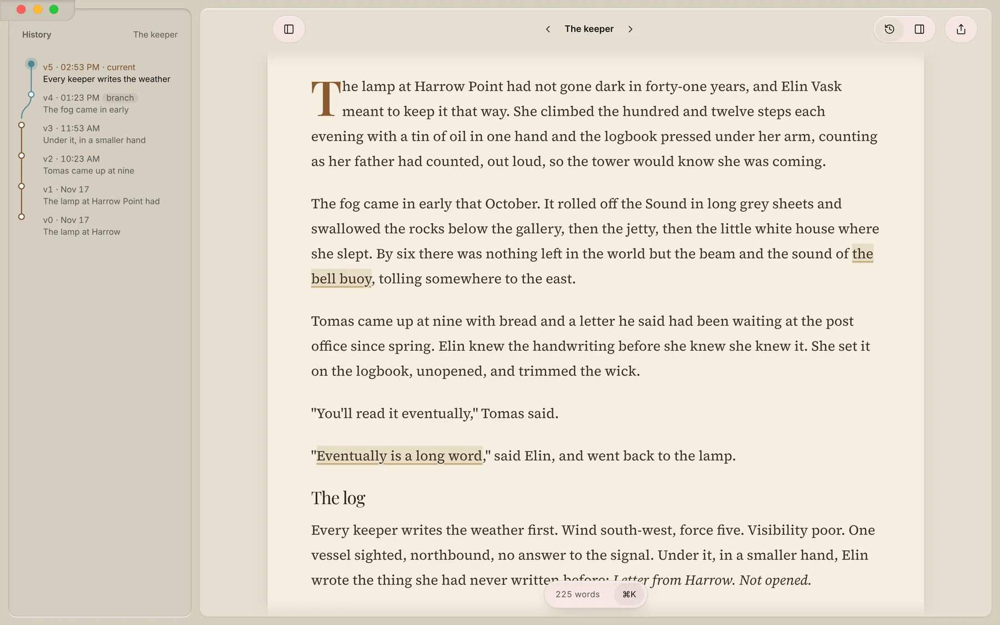

  

<h1 align="center">Memoire</h1>

Writing at the speed of thought.

<picture>
  <source media="(prefers-color-scheme: dark)" srcset="website/assets/shots/style-paper-dark.webp">
  
</picture>

Memoire is a free, open-source writing app for whole books. Your writing is
plain Markdown in a folder on your own disk. An assistant can help when you ask,
running on your own computer or through a hosted model you choose.

## What's new in {{VERSION}}

A new look, and room for the whole book. See the full
[changelog](https://github.com/Riley1101/memorie/blob/main/website/changelog.html)
for everything in this release.

- **A new look.** A translucent window, calmer colours with one warm accent, and a redesigned library, Settings and codex.
- **Margin notes.** Leave yourself a note on any line. Notes stay in place as you edit and never appear in an export.
- **A fuller scene panel.** Status, synopsis and margin notes sit together beside the page.
- **Mentions in the codex.** See every sentence that mentions a character, place or item.
- **Your own order.** Drag writings into the order you want, and export follows it.
- **Recently deleted.** Deleted writings and folders can be restored for 30 days.
- **Book-length speed.** Typing stays smooth in a 500,000-word manuscript, and saving no longer pauses the page.

<picture>
  <source media="(prefers-color-scheme: dark)" srcset="website/assets/shots/inspector-dark.webp">
  
</picture>

## Features

### Write

- **A quiet page** with four page styles (Paper, Classic, Minimal and Technical), each in light and dark.
- **Command palette.** Press ⌘K to find a writing, open the codex or run any command.
- **Margin notes and a scene panel** for status, synopsis and notes on each scene.
- **Goals, not streaks.** Track progress without the guilt loop.

<picture>
  <source media="(prefers-color-scheme: dark)" srcset="website/assets/shots/palette-dark.webp">
  
</picture>

### Organise

- **Binders.** Folders become chapters and writings become scenes, nested as deep as you need, in the order you choose.
- **A library** of cards grouped by when you last wrote, with coloured binders in the sidebar.
- **A codex** for characters, locations, factions and items. Memoire finds each one in your writing.

<picture>
  <source media="(prefers-color-scheme: dark)" srcset="website/assets/shots/grid-dark.webp">
  
</picture>

<picture>
  <source media="(prefers-color-scheme: dark)" srcset="website/assets/shots/codex-dark.webp">
  
</picture>

### Keep every draft

- **Branching history.** Undo history branches instead of overwriting.
- **Compare with any version.** See changes word by word, and keep or undo each one.
- **Recently deleted.** Nothing is lost to a mis-click.

<picture>
  <source media="(prefers-color-scheme: dark)" srcset="website/assets/shots/history-dark.webp">
  
</picture>

### Share and sync

- **Export** to Word, PDF, EPUB, a web page or Markdown, with a title page and table of contents.
- **Optional sync** to your own GitHub repository or Dropbox folder.
- **An assistant that waits to be asked.** Run a model on your computer, or bring an OpenRouter key.

## Install

1. Download the latest macOS build from [Releases](https://github.com/Riley1101/memorie/releases).
2. Open the download and drag **Memoire** into your Applications folder.
3. Launch it and start writing.

## Updates

Memoire checks for new versions in the background and downloads them quietly.
Nothing is installed until you restart, and you'll be offered a restart when an update is ready.
You can also check by hand in **Settings → Updates**.

Every update is signed, and Memoire refuses any update it can't verify.

## Your data

Your writing is plain Markdown on your own disk. Nothing leaves your machine unless you
turn on Git or Dropbox sync, or choose a hosted model.

## Feedback

Found a bug or have an idea? Open an issue at
[github.com/Riley1101/memorie/issues](https://github.com/Riley1101/memorie/issues).

Want to build Memoire from source or contribute? See [CONTRIBUTING.md](CONTRIBUTING.md).

## Roadmap

A mobile companion is planned.

A plugin API is being explored.
